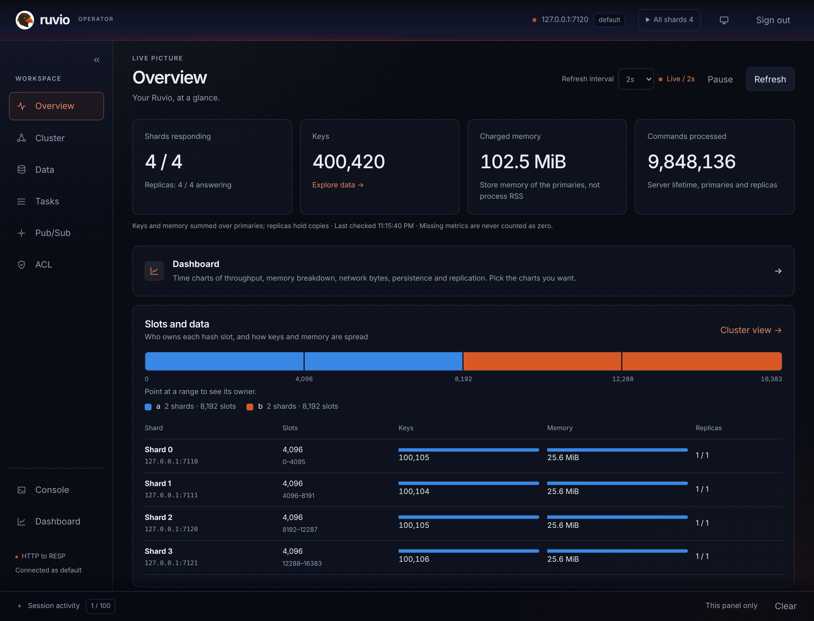

<p align="center">
  <a href="https://ruviodb.com/"></a>
</p>

<h1 align="center">Ruvio</h1>

<p align="center">
  <strong>One process instead of a cache, a lock service, a conditional write, a change feed and a delay queue.</strong><br>
  A Rust key-value server that speaks RESP. <code>redis-cli</code> and existing RESP clients connect.
</p>

<p align="center">
  <a href="https://ruviodb.com/get-started/"><b>Get started</b></a> ·
  <a href="https://ruviodb.com/">Website</a> ·
  <a href="https://ruviodb.com/docs/commands/">Commands</a> ·
  <a href="https://ruviodb.com/benchmarks/">Performance</a> ·
  <a href="https://ruviodb.com/get-started/">Packages</a> ·
  <a href="docs/README.md">Docs</a> ·
  <a href="https://github.com/salihcantekin/ruvio/releases/latest">Releases</a>
</p>

<p align="center">
  <a href="https://github.com/salihcantekin/ruvio/actions/workflows/pr-gate.yml"></a>
  <a href="https://github.com/salihcantekin/ruvio/releases/latest"></a>
  <a href="https://hub.docker.com/r/salihcantekin/ruvio"></a>
  <a href="LICENSE"></a>
  <a href="clients/LICENSE"></a>
  <a href="https://crates.io/crates/ruvio-client"></a>
  <a href="https://www.nuget.org/packages/Ruvio.Client"></a>
  <a href="https://www.npmjs.com/package/ruvio-client"></a>
  <a href="https://pypi.org/project/ruvio-client/"></a>
  <a href="https://aur.archlinux.org/packages/ruvio-bin"></a>
</p>

<p align="center">
  <a href="#why-ruvio">Why Ruvio</a> ·
  <a href="#quick-start">Quick start</a> ·
  <a href="#built-in-building-blocks">Building blocks</a> ·
  <a href="#performance">Performance</a> ·
  <a href="#clients-and-packages">Clients</a> ·
  <a href="#operator-ui">Operator UI</a> ·
  <a href="#documentation">Documentation</a> ·
  <a href="#license">License</a>
</p>

---

## Why Ruvio

The shard that owns a key parses, records, applies, and replies. The hot path does not take a lock and does not hop to another thread.

| Strength | What it means |
| --- | --- |
| **Owner-per-shard engine** | One owner per shard, no lock on apply. A feature allocates only when a key uses it: twenty thousand leases added about 3.6 MB, twenty thousand versioned 64-byte strings about 7.2 MB, body included. |
| **Durability you name** | `memory`, `snapshot`, `everysec` or `always`, chosen at startup. A write is checked, appended, then applied. If the log cannot take the record, the key stays as it was and later writes return `MISCONF`. |
| **Wire compatible** | RESP2, and RESP3 after `HELLO 3`; `redis-cli` and existing RESP clients connect. The command list that CI checks is [docs/compatibility-matrix.json](docs/compatibility-matrix.json). |
| **Six first-party clients** | Rust, C#, Go, Java, Python and Node.js, each with a typed method for every one of the 299 listed commands and cluster routing from one seed address. |
| **Operator UI** | A browser view of one running server: data, command forms, Pub/Sub and ACL users. |

## Quick start

A default process listens on `127.0.0.1:6379`.

```bash
docker run --rm -p 6379:6379 \
  -e RUVIO_REQUIREPASS=change-me \
  -v ruvio-data:/data \
  salihcantekin/ruvio:linux

redis-cli -h 127.0.0.1 -p 6379 -a change-me PING
```

`linux` and `latest` are the same Linux image, as is each version tag, built for linux/amd64 and linux/arm64 (Apple Silicon and other arm64 hosts run it natively). The image default durability is `memory`. A persistent deploy sets `RUVIO_DURABILITY` and keeps the volume.

<details>
<summary><b>Arch Linux (AUR)</b></summary>

<br>

Install the prebuilt binary package from the Arch User Repository (AUR):

```bash
yay -S ruvio-bin
# or
paru -S ruvio-bin
```

Start and enable the systemd service:

```bash
sudo systemctl enable --now ruvio
```

</details>

<details>
<summary><b>Prebuilt binary</b> (Linux x64/arm64, macOS arm64, Windows x64)</summary>

<br>

Download a binary from [GitHub Releases](https://github.com/salihcantekin/ruvio/releases/latest). Each archive holds `ruvio` (the server), `ruvio-ctl` (backup, restore and checks), `ruvio.example.toml`, the README and the license. `SHA256SUMS` lists the checksums.

```bash
# Linux x64; swap the platform for linux-arm64 or macos-arm64
v=0.3.4
curl -LO https://github.com/salihcantekin/ruvio/releases/download/ruvio-$v/ruvio-$v-linux-x64.tar.gz
tar xzf ruvio-$v-linux-x64.tar.gz
cd ruvio-$v-linux-x64
./ruvio --requirepass change-me --data-dir ./data
```

On Windows, unzip `ruvio-<version>-windows-x64.zip` and run `ruvio.exe`. On macOS, a binary downloaded by a browser is quarantined; `xattr -d com.apple.quarantine ruvio ruvio-ctl` clears it (downloads with `curl` are not quarantined). `ruvio --help` lists every flag.

</details>

<details>
<summary><b>From source</b></summary>

<br>

```bash
cargo run --release --bin ruvio
redis-cli -h 127.0.0.1 -p 6379 PING
```

The server is installed from the Docker image, a release binary, or built from this checkout; it is not published as a crate.

</details>

Settings merge in this order: built-in defaults, `ruvio.toml` (template: [`ruvio.example.toml`](ruvio.example.toml)), `RUVIO_*` environment variables, then CLI flags. The file is read once, at process start. See [Configuration](https://ruviodb.com/docs/configuration/).

## Built-in building blocks

These commands run on the shard that owns the key. A key that never uses them stores nothing extra. `GET`, `SET`, and `INCR` do not consult them.

| Command | What it replaces a second system for |
| --- | --- |
| `LEASE` / `RELEASE` | A fencing token for one key. The shard is the holder. Tokens only grow: after expiry, `RELEASE`, `DEL`, a restart, a failover or a slot move, the next grant is larger. The grant is a WAL record. `GET` of a lease is `WRONGTYPE`. |
| `SEMAPHORE` / `RELEASE` | At most N holders at once, each with its own TTL. A crashed holder frees its slot when its TTL passes. The first holder stays in the object; each further holder is 16 bytes. The key goes away with the last one. |
| `INCRBY ... MAX` | A counter that never passes a capacity. A refused call returns nil and changes nothing, so no compensating `DECR`. |
| `SETV` | A conditional string write. The call succeeds only when the caller still has the current version, so two clients cannot both turn 12 into 11. The version exists only on keys written with `SETV`. |
| `CHANGES` | `CHANGES START` arms an in-memory feed of later `SET`, `SETV`, `LEASE`, and `RELEASE` notes on that shard. Nothing is recorded before `START`. The feed is not the WAL, and it is empty after restart. |
| `XADD DELAY` | The stream entry is stored now. `XREADGROUP` skips it until the delay passes. `XREAD` can still see it. The hold is a WAL record and a snapshot trailer, and it is written only when a delay is set. |
| `LIMIT` | A fixed-window, sliding-window or token-bucket rate limit in one call, with fixed state per key. A refused call writes nothing. |
| `IDEM` | Request de-duplication on the shard that owns the key: `BEGIN` tells a caller to run, wait or conflict, and a repeat of a finished request gets the saved result. |
| `FILLGET` / `FILLSET` | One caller refills a missing or stale cache entry while the others get `BUSY` or the stale value. The markers live in memory only. |
| `TRANSFER` | Moves an amount between two integer strings of one slot in one WAL record, with an optional cap on the destination. |
| `CHANGES SUBSCRIBE` | A resumable push stream of this shard's WAL, with a cursor to continue from after a disconnect or restart. |
| `JSON.INDEX` | A field index over JSON documents with a key prefix, so a lookup by field does not scan. |
| `CLIENT DURABILITY` | Holds this connection's replies until `n` replicas have the writes on disk; `ruvio coordinator` fails over only to a replica that has them. |

`SET` replaces a versioned string with a plain string. `INCR` does not accept a versioned string.

## Performance

| | Result | Setup |
| --- | --- | --- |
| **Against Redis 8.10.2** | 59 of 60 commands at or above 0.97×, geometric mean 1.22× | 4-core Azure x86 VM, one shard, `memory` durability, 50 clients, pipeline 16, 64-byte values, five alternating rounds (2026-10-11) |
| **Whole machine, 8 shards** | against an 8-node Redis Cluster on the same 8 cores: geometric mean 1.13× over 59 commands at pipeline 16 (55 at or above 0.97×, none below 0.90×), 1.23× at pipeline 64 (`GET` 1.75×, `SET` 2.21×, 29M and 30M req/s), 1.14× with every write logged (`everysec` against AOF `everysec`); memory per shard 0.96× of one Redis | 16-core Azure EPYC 9V74 VM, one process with 8 shards (`port_mode = "per-shard"`), one `redis-benchmark` per shard, three alternating rounds ([record](docs/evidence/2026-10-16-azure-8-shards.md), 2026-10-16) |
| **Raw throughput** | about 2.61M `SET`/s, 2.74M `GET`/s, 2.88M `INCR`/s | Apple M4 Pro, evented, `memory` durability, one shard, 50 clients, pipeline 16, 64-byte values, fixed key, median of 3 rounds (2026-10-07) |

Samples, flags and the rows below 1× are on the [performance page](https://ruviodb.com/benchmarks/); memory results are on the [memory page](https://ruviodb.com/benchmarks/#memory). There is no Garnet measurement.


## Clients and packages

First-party clients speak RESP2, do not send `CLIENT SETINFO`, and learn `CLUSTER SLOTS` from one seed address. Guides: [Clients](https://ruviodb.com/docs/clients/) · [`clients/`](clients/README.md).

| Language | Install | Package |
| --- | --- | --- |
| Rust | `cargo add ruvio-client` | [crates.io](https://crates.io/crates/ruvio-client) |
| C# | `dotnet add package Ruvio.Client` | [NuGet](https://www.nuget.org/packages/Ruvio.Client) |
| Node.js | `npm install ruvio-client` | [npm](https://www.npmjs.com/package/ruvio-client) |
| Python | `pip install ruvio-client` | [PyPI](https://pypi.org/project/ruvio-client/) |
| Java | `io.github.salihcantekin:ruvio-client` | [Maven Central](https://central.sonatype.com/artifact/io.github.salihcantekin/ruvio-client) |
| Go | `go get github.com/salihcantekin/ruvio/clients/go` | [pkg.go.dev](https://pkg.go.dev/github.com/salihcantekin/ruvio/clients/go) |

```rust
use ruvio_client::Client;

let mut db = Client::connect("127.0.0.1", 6379)?;
db.set("session:ada", "hello")?;
let value = db.get_string("session:ada")?;
db.incr("visits")?;
```

```csharp
using Ruvio.Client;

await using var connection = await RuvioConnection.ConnectAsync("127.0.0.1", 6379);
var db = await connection.GetDefaultDatabaseAsync();
await db.SetAsync("session:ada", "hello");
string? value = await db.GetStringAsync("session:ada");
```

The [.NET integration packages](integrations/dotnet/README.md) provide an `IDistributedCache` provider, ASP.NET Core output caching and Data Protection key-ring storage, plus opt-in rate limiting, HTTP idempotency and distributed locks. They are separate packages; existing server commands and applications that do not enable them incur no new per-key feature state.

[Native `IDEM`](docs/IDEM.md) adds atomic reservation, ownership checks, fingerprint conflicts and binary result replay for any RESP client. The ASP.NET Core idempotency package uses this command, not Lua. `ONCE` remains the simpler TTL marker. Retention and durability bound deduplication; external side effects still require their own transaction/idempotency mechanism.

<details>
<summary><b>All published packages and live versions</b></summary>

<br>

Releases are cut from `main` by hand ([release workflow](.github/workflows/release.yml)). Counts come live from the registries. All clients are in [`clients/`](clients/README.md). The Go module is released by git tag (`clients/go/vX.Y.Z`) and fetched through the Go module proxy.

| Package | What it is | Version | Downloads |
| --- | --- | --- | --- |
| [ruvio-client](https://crates.io/crates/ruvio-client) | Rust SDK |  |  |
| [Ruvio.Client](https://www.nuget.org/packages/Ruvio.Client) | C# SDK |  |  |
| [Ruvio.Client.AspNetCore](https://www.nuget.org/packages/Ruvio.Client.AspNetCore) | ASP.NET Core registration and health checks |  |  |
| [Ruvio.Extensions.Caching](https://www.nuget.org/packages/Ruvio.Extensions.Caching) | `IDistributedCache` provider |  |  |
| [Ruvio.AspNetCore.OutputCaching](https://www.nuget.org/packages/Ruvio.AspNetCore.OutputCaching) | Output-cache store with tag invalidation |  |  |
| [Ruvio.AspNetCore.DataProtection](https://www.nuget.org/packages/Ruvio.AspNetCore.DataProtection) | Data Protection key-ring storage |  |  |
| [Ruvio.AspNetCore.RateLimiting](https://www.nuget.org/packages/Ruvio.AspNetCore.RateLimiting) | Distributed rate limiting |  |  |
| [Ruvio.AspNetCore.Idempotency](https://www.nuget.org/packages/Ruvio.AspNetCore.Idempotency) | HTTP idempotency |  |  |
| [Ruvio.AspNetCore.DistributedLock](https://www.nuget.org/packages/Ruvio.AspNetCore.DistributedLock) | Distributed locks and `[RuvioLock]` |  |  |
| [ruvio-client (npm)](https://www.npmjs.com/package/ruvio-client) | Node.js SDK |  |  |
| [ruvio-client (PyPI)](https://pypi.org/project/ruvio-client/) | Python SDK |  |  |
| [io.github.salihcantekin:ruvio-client](https://central.sonatype.com/artifact/io.github.salihcantekin/ruvio-client) | Java SDK |  | |
| [github.com/salihcantekin/ruvio/clients/go](https://pkg.go.dev/github.com/salihcantekin/ruvio/clients/go) | Go SDK | `clients/go/v0.2.0` | |
| [Server binaries](https://github.com/salihcantekin/ruvio/releases/latest) | `ruvio` and `ruvio-ctl` for Linux, macOS, Windows |  |  |
| [salihcantekin/ruvio](https://hub.docker.com/r/salihcantekin/ruvio) | Server image (amd64, arm64) |  |  |
| [salihcantekin/ruvio-ui](https://hub.docker.com/r/salihcantekin/ruvio-ui) | Operator UI image |  |  |

Live install lines and download counts: [Packages](https://ruviodb.com/get-started/).

</details>

## Operator UI

[salihcantekin/ruvio-ui](https://hub.docker.com/r/salihcantekin/ruvio-ui) is a browser for one running server. `RUVIO_UI_TARGET_HOST` and `RUVIO_UI_TARGET_PORT` are that Ruvio process, the same address `redis-cli` uses. A default server is `127.0.0.1:6379`. Port `8080` is only the UI.

```bash
docker run --rm -p 8080:8080 \
  -e RUVIO_UI_TARGET_HOST=127.0.0.1 \
  -e RUVIO_UI_TARGET_PORT=6379 \
  salihcantekin/ruvio-ui:linux
```

Open http://127.0.0.1:8080. Sign-in is the server ACL user. An empty user and password connect as `default`. If the server was started with `RUVIO_REQUIREPASS`, type that password on the sign-in screen, or set `RUVIO_UI_TARGET_PASSWORD` so the field is filled in. Tags `linux` and `latest` are the same image.

<p align="center">
  
</p>

<p align="center">
  
  
</p>

The Console tab runs commands directly, with formatted and size-capped replies, copy and download of the full result, and a confirmation before destructive commands.

All shards lists every key. One shard pins Data, the command screens, and Pub/Sub to that node. Users are `ACL` identities: `default` always exists, extra users that survive a restart live in `ruvio.toml`, and `ACL SETUSER` lasts until the next start. Install notes: [Operator UI](https://ruviodb.com/get-started/#ui).

## Compared with Redis, Dragonfly and Garnet

The differences are about ownership, the durability contract, and how much of the Redis surface is implemented. Measured results are in [Performance](#performance). How a Ruvio process runs is on [How it runs](https://ruviodb.com/benchmarks/).

| | Redis | Dragonfly | Garnet | Ruvio |
| --- | --- | --- | --- | --- |
| Runtime | C | C++ | .NET, Tsavorite | Rust, in-memory shard + WAL |
| Wire | RESP2/3, full surface | Redis and Memcached | Redis-compatible | RESP2 subset, listed in CI |
| Hot path | Shared engine, I/O threads | Single-node throughput | Separate string and object stores | One owner per shard, no lock on apply |
| Cluster | Bus, migration, failover | Its own scale story | Cluster-capable store | Static 16,384 slots, misrouted keys forwarded; automatic failover of a primary and its replicas with `ruvio coordinator` |
| Durability | RDB, AOF, combinations | Snapshots | Tsavorite on disk | `memory`, `snapshot`, `everysec`, `always` |
| Keep the other when | You need modules, the full Sentinel feature set, or a command Ruvio does not list | You want that single-node scale claim | You want a .NET stack and Tsavorite as the store | The written subset and the shard contract are enough |

Not claimed: a cluster bus, automatic rebalancing (slot ranges move between the shards of one process with `RUVIO MOVESLOTS`, and between machines when an operator asks `ruvio coordinator`), failover across a multi-node cluster (failover covers one primary and its replicas, through `ruvio coordinator`), or a hardware latency number. Replication copies a WAL tail to a bounded set of replicas. Classic `PUBLISH` reaches subscribers on every shard of one process, not other processes.

### Docker Desktop and memory density

The capped Docker Desktop comparison (containers limited to 4 CPUs and 2 GiB, 2026-10-01) is in [the 2026-10-07 benchmark record](docs/evidence/2026-10-07-benchmark-results.md#capped-docker-desktop-comparison-2026-10-01).

Docker RSS is not the bare-metal result; the memory detail is in [the string memory density record](docs/evidence/2026-09-28-string-memory-density.md) and on the [memory page](https://ruviodb.com/benchmarks/#memory). Natively on this Mac, 1,000,000 `LIMIT` keys added 148.9 MiB against 85.9 MiB for 1,000,000 plain 64-byte strings, about 1.7× per key.

## Repository layout

| Path | Contents |
| --- | --- |
| [`src/`](src) | The server. |
| [`clients/`](clients/README.md) | Rust, C#, Go, Java, Python and Node.js SDKs, and the operator UI. |
| [`integrations/`](integrations/README.md) | .NET framework integrations. |
| [`docs/`](docs/README.md) | Configuration, compatibility, recovery, threat model. |
| [`site-next/`](site-next) | The website, [ruviodb.com](https://ruviodb.com), built with Astro from `docs/`, `clients/` and `integrations/` and published by the manual `site-azure` workflow. |
| [`deploy/`](deploy/README.md) | systemd unit, Kubernetes example, local Docker stack. |
| [`tests/`](tests/README.md), [`fuzz/`](fuzz/README.md), [`benches/`](benches/README.md) | Integration tests, libFuzzer targets, instruction-count benchmark. |
| [`examples/`](examples/README.md), [`scripts/`](scripts/README.md), `benchmark/` | Contributor probes, check and release scripts, the benchmark script (result files stay local). |
| `ruvio.example.toml` | Default server settings; written as `ruvio.toml` on first start. |

## Documentation

| Page | Covers |
| --- | --- |
| [Start](https://ruviodb.com/get-started/) | Checkout, adapters, Docker |
| [Configuration](https://ruviodb.com/docs/configuration/) | TOML, environment, ACL users |
| [Commands](https://ruviodb.com/docs/commands/) | The supported surface |
| [Durability](https://ruviodb.com/docs/recovery/) | Acknowledgement boundaries |
| [Replication](https://ruviodb.com/docs/recovery/) | WAL tail, reads from replicas, `REPLICAOF` |
| [Automatic failover](https://ruviodb.com/docs/coordinator/) | `ruvio coordinator`: Raft-agreed failover, Sentinel-compatible discovery |
| [Operations](https://ruviodb.com/docs/observability/) | Limits, metrics, shutdown |
| [Testing and evidence](https://ruviodb.com/docs/testing/) | Test coverage, recorded results, open production evidence gates |
| [docs/THREAT_MODEL.md](docs/THREAT_MODEL.md) | What the process does and does not defend |
| [docs/ROADMAP.md](docs/ROADMAP.md) | Open gates, including a 24-hour soak and published bare-metal latency |
| [docs/RECOVERY.md](docs/RECOVERY.md#promote-a-replica-by-hand) | Promote a caught-up replica by hand |
| [docs/RESILIENCE.md](docs/RESILIENCE.md) | Crash, power-loss and disk-fault testing and what it found |
| [docs/TESTING.md](docs/TESTING.md) | Contributor test guide |

## Contributing and security

Read [CONTRIBUTING.md](CONTRIBUTING.md) before opening a pull request. Report a vulnerability in private as described in [SECURITY.md](SECURITY.md).

## License

The server (`src/`, the `ruvio` binary and the server image) is licensed under the [GNU Affero General Public License v3.0](LICENSE) (`AGPL-3.0-only`). Copyright (c) 2026 Salih Cantekin.

In short: you can run, study and modify the server. If you offer a modified version to others, including as a network service, you must make your modified source available under the same license. Running an unmodified server, and talking to it from your own application, does not put that application under the AGPL.

The operator UI (`clients/ruvio-ui/`, the `ruvio-ui` image) is licensed under the [AGPL-3.0](clients/ruvio-ui/LICENSE) as well.

The client libraries and integrations are separate works under the [MIT license](clients/LICENSE): the Rust SDK and C# SDK in `clients/`, and `integrations/` ([license](integrations/LICENSE)).

Versions published before the switch to AGPL-3.0 (server 0.3.0 and earlier) remain available under the MIT license to those who received them.
